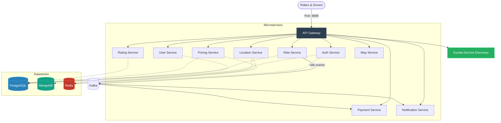

# 🚗 Ride-Hailing Microservices Platform

A production-ready, cloud-native microservices ecosystem designed to power a scalable ride-hailing platform. Built with **Spring Boot 3.x**, **Spring Cloud**, **PostgreSQL**, **MongoDB**, **Redis**, and orchestrated with **Docker Compose**.

---

## 🏗️ System Architecture

The platform uses a decentralized microservices architecture where each service has a single responsibility and maintains its own database schema (Database-per-Service pattern). 



---

## 🧩 Microservices Directory

| Service Name | Port | Description | Primary Stack |
| :--- | :---: | :--- | :--- |
| **Eureka Server** | `8761` | Service Registry & Discovery for all microservices. | Spring Cloud Eureka Server |
| **Config Server** | `8889` | Centralized configuration for all services, served from `./config-repo`. Secrets stay in `.env` and are injected per container. | Spring Cloud Config Server |
| **API Gateway** | `8888` | Main entry point for clients. Handles routing and security filter integration. | Spring Cloud Gateway |
| **Auth Service** | `8081` | Core authentication provider: registration with OTP email verification, Google sign-in (ID token verification, account linking, find-or-create), JWT access/refresh issuance, password reset, user profile + avatars, admin user stats. | Spring Boot Security, JWT, Redis, PostgreSQL, Google Identity |
| **User Service** | `8082` | Handles user roles (Riders/Drivers), vehicle registration, and profile detail management. | Spring Data JPA, PostgreSQL |
| **Ride Service** | `8083` | Manages the ride lifecycle (`REQUESTED`, `IN_PROGRESS`, `COMPLETED`, `CANCELLED`), booking calculations, and matches drivers. | Spring Data JPA, PostgreSQL |
| **Location Service** | `8084` | Real-time driver location updates, geo-indexing, and geospatial query tracking. | MongoDB (2dsphere), Redis, Spring Boot |
| **Pricing Service** | `8085` | Dynamic pricing engine utilizing base rates, per-kilometer/per-minute rules, and surge multipliers. | Spring Data JPA, Redis, PostgreSQL |
| **Rating Service** | `8088` | Stores, records, and aggregates ratings between riders and drivers post-ride. | Spring Data JPA, PostgreSQL |
| **Map Service** | `8089` | Internal routing proxy, distance computations, and external mapping provider integration. | Spring Boot |
| **Payment Service** | `8086` | Creates a payment per completed ride from Kafka events, charges via Stripe (test mode) with idempotency keys, verifies webhooks by signature, and publishes payment events. Falls back to a simulated gateway without a key. | Spring Kafka, Stripe, PostgreSQL |
| **Notification Service** | `8090` | Consumes ride lifecycle events from Kafka and delivers notifications in-app (REST), over WebSocket (STOMP), with a pluggable channel design. | Spring Kafka, WebSocket, PostgreSQL |

---

## 🗄️ Database Architecture

The platform uses a hybrid storage layer customized for performance constraints:
1. **PostgreSQL**: Stores relational, transaction-critical data like user credentials, payment details, ride billing/fares, pricing configurations, and historical ratings.
2. **MongoDB**: Leveraged by `location-service` to run high-performance spatial queries (`$nearSphere`) and track real-time coordinate streams.
3. **Redis**: Utilized as a caching layer for active JWT token validations, fast location-lookup reads, and dynamic pricing caches.

### Automated Initialization & Seeding
All database schemas are automatically initialized, schemas built, and sample data seeded upon running the containerized PostgreSQL and MongoDB servers via:
* `./postgres/init/00-create-databases.sql` creates the five databases (`auth_db`, `user_db`, `ride_db`, `pricing_db`, `rating_db`); each service then builds its own schema via JPA.
* `./mongodb/init/01-seed.js` creates the `location_db.driver_locations` collection with its `2dsphere` geo index.

---

## 🚀 Getting Started

### Prerequisites
* Java 17 SDK (or higher)
* Maven 3.8+ (or use the included `./mvnw`)
* Docker and Docker Compose

### 1. Environment Configuration
Create a `.env` file in the root directory (based on the sample properties below):

```env
# Database Credentials
POSTGRES_USER=postgres
POSTGRES_PASSWORD=postgres
MONGO_USER=mongo
MONGO_PASSWORD=mongo
SPRING_DATA_REDIS_PASSWORD=redis123

# Security
JWT_SECRET=generate_a_long_random_base64_secret

# Optional Integrations
SPRING_MAIL_HOST=smtp.gmail.com
MAIL_PORT=587
MAIL_USERNAME=your_smtp_user
MAIL_PASSWORD=your_smtp_password
# Payment gateway: simulated by default; set STRIPE_ENABLED=true with a test key for Stripe test mode
STRIPE_ENABLED=false
STRIPE_SECRET_KEY=
STRIPE_WEBHOOK_SECRET=
# Google sign-in: create an OAuth 2.0 Client ID (Web) in Google Cloud Console and paste it here;
# add your app origins (e.g. http://localhost:8080) under Authorized JavaScript origins.
# Leave empty to hide the Google button and disable the endpoint.
GOOGLE_CLIENT_ID=
```

### 2. Building the Project
From the root directory, compile and build the JARs for all services:
```bash
./mvnw clean package -DskipTests
```

### 3. Launching Infrastructure & Microservices
Run the entire stack using Docker Compose:
```bash
docker compose up --build -d
```

Verify that all services are up and healthy:
```bash
docker compose ps
```

---

## 🔗 Gateway Routing Table

All client traffic goes through the **API Gateway** on port `8888`, which validates JWTs at the edge and applies per-route rate limits. Public paths are register / login / Google sign-in / OTP verification / password reset only; everything else needs a valid token.

| Target Service | Path Prefix | Example Endpoint |
| :--- | :--- | :--- |
| **Auth Service** | `/api/auth/**` | `POST http://localhost:8888/api/auth/register` |
| **User Service** | `/api/users/**`, `/api/drivers/**`, `/api/vehicles/**` | `GET http://localhost:8888/api/drivers/{id}` |
| **Ride Service** | `/api/rides/**` | `POST http://localhost:8888/api/rides/request` |
| **Location Service** | `/api/location/**` | `POST http://localhost:8888/api/location/update` |
| **Pricing Service** | `/api/pricing/**` | `GET http://localhost:8888/api/pricing/estimate` |
| **Map Service** | `/api/maps/**` | `GET http://localhost:8888/api/maps/route` |
| **Payment Service** | `/api/payments/**` | `GET http://localhost:8888/api/payments/me` |
| **Notification Service** | `/api/notifications/**` | `GET http://localhost:8888/api/notifications/me` |
| **WebSockets** | `/ws/location/**`, `/ws/notifications/**` | live driver location + notification streams |

---

## 📱 Angular Frontend

A mobile-first **Angular 20** app (standalone components + signals) lives in `./frontend`:

- Design system with CSS custom-property tokens, **dark and light themes**, full **English + Arabic (RTL)** support, reduced-motion and focus-ring accessibility.
- **Leaflet + OpenStreetMap** maps with no paid API keys: tap-to-set pickup/dropoff, real OSRM route geometry, theme-matched tiles.
- Tiered fare estimates with promo codes, ride request/cancel, **fare negotiation** (offer / counter / accept), test-mode payment and itemized receipt.
- **Driver mode:** go online, location + breadcrumb reporting loop, incoming-request card, accept/start/complete, earnings chart.
- Trip history with animated **trail replay**, profile page with avatar upload, live notifications over WebSocket.
- Served by nginx in Docker (`frontend` service in compose) and production-built in CI.

## ⭐ Product Highlights

- **5 ride tiers** (MOTO, STANDARD, COMFORT, XL, PREMIUM) with per-tier base + per-km pricing.
- **Fare negotiation:** rider proposes a price, driver counters or accepts - inDrive-style on top of metered estimates.
- **Event-driven payments:** a Kafka ride-completed event creates the payment; charges go through a pluggable gateway (Stripe test mode behind `STRIPE_ENABLED`, simulator by default) with idempotency keys; receipts are ownership-checked.
- **Scheduled jobs under ShedLock** (one replica runs each job): stale-ride expiry, daily driver-earnings rollups, location cleanup, stale-driver sweep.
- **Driver earnings** daily chart and **admin dashboards** (users by role, rides by status, revenue) gated by `ROLE_ADMIN`.
- **Security:** OTP email verification, Google sign-in with server-side ID token verification (audience + issuer checked against your client ID), JWT access/refresh tokens, gateway-edge token validation, security headers, per-route Redis rate limiting.

## ✅ CI / CD & Testing

Every push to `main` runs the GitHub Actions pipeline (`.github/workflows/ci.yml`):

1. **Build + unit tests** for all 12 backend services and the Eureka/Config servers.
2. **Compose smoke test:** the full `docker compose` stack must come up healthy, which includes the Angular production build (`ng build --configuration production` inside the frontend image).
3. **End-to-end suite** (`scripts/e2e.sh`, 15 steps) against the real running stack: register -> OTP verify (via MailHog) -> login -> profile + avatar -> driver online + location -> promo + tiered estimates -> ride request/accept/start/complete with breadcrumbs -> Kafka payment -> charge + receipt -> notifications -> driver earnings.

## 📚 Documentation

- Milestone docs: `docs/milestones/M0` ... `M8` (what each milestone shipped, in plain language).
- Runbooks: `docs/runbooks/` (e.g. JWT secret rotation).

---

## 🛠️ Diagnostics & Monitoring

### Service Registry (Eureka Dashboard)
Once the containers are running, navigate to [http://localhost:8761](http://localhost:8761) to view registered microservices, instances, status, and health indicators.

### Spring Boot Actuator Endpoints
Each service exposes health indicators via Spring Boot Actuator:
```bash
# Example check on the Ride Service
curl http://localhost:8083/actuator/health
```

### pgAdmin Panel
Manage PostgreSQL databases in a visual dashboard:
* **URL**: [http://localhost:5050](http://localhost:5050)
* **Login Email**: `admin@admin.com`
* **Login Password**: `admin123`
