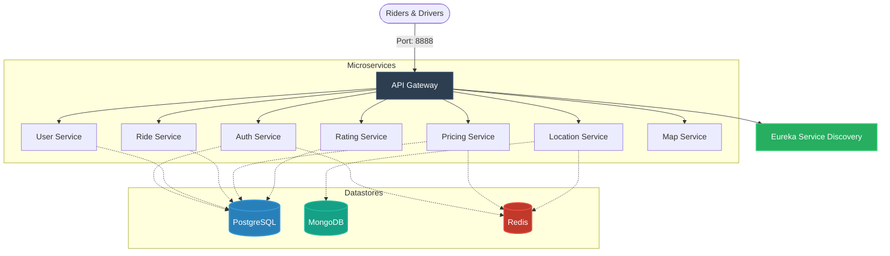

# 🚗 Ride-Hailing Microservices Platform

A production-ready, cloud-native microservices ecosystem designed to power a scalable ride-hailing platform. Built with **Spring Boot 3.x**, **Spring Cloud**, **PostgreSQL**, **MongoDB**, **Redis**, and orchestrated with **Docker Compose**.

---

## 🏗️ System Architecture

The platform uses a decentralized microservices architecture where each service has a single responsibility and maintains its own database schema (Database-per-Service pattern). 



---

## 🧩 Microservices Directory

| Service Name | Port | Description | Primary Stack |
| :--- | :---: | :--- | :--- |
| **Eureka Server** | `8761` | Service Registry & Discovery for all microservices. | Spring Cloud Eureka Server |
| **Config Server** | `8889` | Centralized configuration for all services, served from `./config-repo`. Secrets stay in `.env` and are injected per container. | Spring Cloud Config Server |
| **API Gateway** | `8888` | Main entry point for clients. Handles routing and security filter integration. | Spring Cloud Gateway |
| **Auth Service** | `8081` | Core authentication provider. Manages JWT issuances, hashing passwords, registration, and Google OAuth integration. | Spring Boot Security, JWT, Redis, PostgreSQL |
| **User Service** | `8082` | Handles user roles (Riders/Drivers), vehicle registration, and profile detail management. | Spring Data JPA, PostgreSQL |
| **Ride Service** | `8083` | Manages the ride lifecycle (`REQUESTED`, `IN_PROGRESS`, `COMPLETED`, `CANCELLED`), booking calculations, and matches drivers. | Spring Data JPA, PostgreSQL |
| **Location Service** | `8084` | Real-time driver location updates, geo-indexing, and geospatial query tracking. | MongoDB (2dsphere), Redis, Spring Boot |
| **Pricing Service** | `8085` | Dynamic pricing engine utilizing base rates, per-kilometer/per-minute rules, and surge multipliers. | Spring Data JPA, Redis, PostgreSQL |
| **Rating Service** | `8088` | Stores, records, and aggregates ratings between riders and drivers post-ride. | Spring Data JPA, PostgreSQL |
| **Map Service** | `8089` | Internal routing proxy, distance computations, and external mapping provider integration. | Spring Boot |
| **Payment Service** | `8086` | Creates a payment per completed ride from Kafka events, charges via Stripe (test mode) with idempotency keys, verifies webhooks by signature, and publishes payment events. Falls back to a simulated gateway without a key. | Spring Kafka, Stripe, PostgreSQL |
| **Notification Service** | `8090` | Consumes ride lifecycle events from Kafka and delivers notifications in-app (REST), over WebSocket (STOMP), with a pluggable channel design. | Spring Kafka, WebSocket, PostgreSQL |

---

## 🗄️ Database Architecture

The platform uses a hybrid storage layer customized for performance constraints:
1. **PostgreSQL**: Stores relational, transaction-critical data like user credentials, payment details, ride billing/fares, pricing configurations, and historical ratings.
2. **MongoDB**: Leveraged by `location-service` to run high-performance spatial queries (`$nearSphere`) and track real-time coordinate streams.
3. **Redis**: Utilized as a caching layer for active JWT token validations, fast location-lookup reads, and dynamic pricing caches.

### Automated Initialization & Seeding
All database schemas are automatically initialized, schemas built, and sample data seeded upon running the containerized PostgreSQL and MongoDB servers via:
* `./postgres/init/00-create-databases.sql` creates the five databases (`auth_db`, `user_db`, `ride_db`, `pricing_db`, `rating_db`); each service then builds its own schema via JPA.
* `./mongodb/init/01-seed.js` creates the `location_db.driver_locations` collection with its `2dsphere` geo index.

---

## 🚀 Getting Started

### Prerequisites
* Java 17 SDK (or higher)
* Maven 3.8+ (or use the included `./mvnw`)
* Docker and Docker Compose

### 1. Environment Configuration
Create a `.env` file in the root directory (based on the sample properties below):

```env
# Database Credentials
POSTGRES_USER=postgres
POSTGRES_PASSWORD=postgres
MONGO_USER=mongo
MONGO_PASSWORD=mongo
SPRING_DATA_REDIS_PASSWORD=redis123

# Security
JWT_SECRET=generate_a_long_random_base64_secret

# Optional Integrations
SPRING_MAIL_HOST=smtp.gmail.com
MAIL_PORT=587
MAIL_USERNAME=your_smtp_user
MAIL_PASSWORD=your_smtp_password
STRIPE_SECRET_KEY=your_stripe_secret_key
STRIPE_WEBHOOK_SECRET=
GOOGLE_CLIENT_ID=your_google_client_id
GOOGLE_CLIENT_SECRET=your_google_client_secret
```

### 2. Building the Project
From the root directory, compile and build the JARs for all services:
```bash
./mvnw clean package -DskipTests
```

### 3. Launching Infrastructure & Microservices
Run the entire stack using Docker Compose:
```bash
docker compose up --build -d
```

Verify that all services are up and healthy:
```bash
docker compose ps
```

---

## 🔗 Gateway Routing Table

All microservices are reachable through the **API Gateway** on port `8888`. Below is the path routing mapping:

| Target Service | Path Prefix | Example Endpoint |
| :--- | :--- | :--- |
| **Auth Service** | `/api/auth/**` | `POST http://localhost:8888/auth-service/api/auth/register` |
| **User Service** | `/api/users/**` | `GET http://localhost:8888/user-service/api/drivers/drivers/{id}` |
| **Ride Service** | `/api/rides/**` | `POST http://localhost:8888/ride-service/api/rides/request` |
| **Location Service** | `/api/location/**` | `POST http://localhost:8888/location-service/api/location/update` |
| **Pricing Service** | `/api/pricing/**` | `GET http://localhost:8888/pricing-service/api/pricing/estimate` |
| **Rating Service** | `/api/ratings/**` | `POST http://localhost:8888/rating-service/api/ratings/submit` |

---

## 🛠️ Diagnostics & Monitoring

### Service Registry (Eureka Dashboard)
Once the containers are running, navigate to [http://localhost:8761](http://localhost:8761) to view registered microservices, instances, status, and health indicators.

### Spring Boot Actuator Endpoints
Each service exposes health indicators via Spring Boot Actuator:
```bash
# Example check on the Ride Service
curl http://localhost:8083/actuator/health
```

### pgAdmin Panel
Manage PostgreSQL databases in a visual dashboard:
* **URL**: [http://localhost:5050](http://localhost:5050)
* **Login Email**: `admin@admin.com`
* **Login Password**: `admin123`
